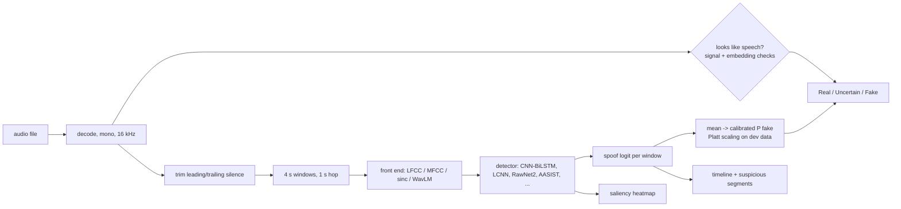

# Audio Deepfake Detection (v2)

Detects synthetic or converted speech in an audio recording and explains its answer.
Version 2 rebuilds the original CNN-BiLSTM project (paper in `Research_Paper/`) as a
leak-free, cross-dataset research pipeline in PyTorch, with a web app and a REST API.

**What you get for any audio file**

- a calibrated **Real / Uncertain / Fake** verdict with a probability;
- a warning when the input **does not look like speech** (tones, noise, music, silence) instead of a confident wrong answer;
- the **score over time** (4 s windows) with the most suspicious segments, playable;
- the **spectrogram with a saliency heatmap** of what moved the score;
- every model's opinion side by side, batch scoring to CSV, and an HTML report.
- a **trust panel**: how often verdicts with the same confidence and model agreement were right on held-out data;
- a full app, not only the detector: overview, batch, session history, results,
  error analysis, model card and help (`ui/`; research pages never load PyTorch).

> **Honest limits.** Models are trained on ASVspoof 2019 LA (English, studio quality, 2019-era
> attacks). The app's default, a fine-tuned WavLM-Base+ model, reaches 10.7% EER on real-world
> In-the-Wild audio; every spectrogram or raw-waveform model is at 36–72%. Its decision threshold
> still misses many real-world fakes (it calls the DEEP-VOICE demonstration fake "Real"), so treat any
> single verdict as a hint, never as proof. See the results below and [`docs/MODEL_CARD.md`](docs/MODEL_CARD.md).

## Quick start

```bash
python -m venv .venv-torch
.venv-torch/Scripts/pip install -r requirements-train.txt   # GPU (CUDA 13); CPU only: requirements.txt
.venv-torch/Scripts/pip install -e .
```

Trained models live in `runs/<run name>/` (`best.pt`, `reliability.json`); they are not stored in git.

```bash
streamlit run app.py                                  # web app, http://localhost:8501
uvicorn api.main:app --port 8000                      # REST API, docs at http://localhost:8000/docs
python -m adfd.explain clip.wav                       # verdict + timeline.png + heatmap.png
docker compose up                                     # app + API (CPU), mounts ./runs
```

API example:

```bash
curl -F "file=@clip.wav" "http://127.0.0.1:8000/predict?timeline=true"
```

## How it works



Design rules (see [`docs/IMPLEMENTATION_PLAN.md`](docs/IMPLEMENTATION_PLAN.md)):
train on ASVspoof 2019 LA **train**, choose every model, threshold and calibration on
ASVspoof **dev** only, and only *report* the test sets: ASVspoof 2019 LA eval (unseen attacks
A07–A19), In-the-Wild and DEEP-VOICE. Every headline number is a mean over 3 seeds.

## Results

EER in % (lower is better), mean ± std over 3 seeds unless marked. Full tables:
[`experiments/tables/phase2.md`](experiments/tables/phase2.md), `experiments/tables/phase3.md`.

| Model | ASVspoof eval | In-the-Wild | DEEP-VOICE (per recording) | degraded eval (10 codecs/noises) |
|---|---|---|---|---|
| E1 CNN-BiLSTM, MFCC (the v1 paper model, honest protocol) | 7.97 ± 0.04 | 47.3 ± 4.6 | 52.4 ± 6.6 | 33.6 ± 3.9 |
| E2a same, LFCC | 6.64 ± 1.52 | 42.5 ± 6.6 | 45.5 ± 7.1 | 32.4 ± 0.9 |
| E4a LFCC, silence-trimmed, RawBoost (Phase 2 pick) | 14.38 ± 1.09 | 47.4 ± 11.4 | 50.3 ± 13.0 | 24.5 ± 2.3 |
| E5a LCNN, LFCC (1 seed) | 15.36 | 53.6 | 25.0 | 26.4 |
| E5b RawNet2, raw waveform (1 seed, 12 epochs) | 19.51 | 44.9 | 50.9 | 25.9 |
| E6b SE-ResNet CNN-BiLSTM-Att, LFCC (1 seed, 15 epochs) | 17.73 | 71.8 | 25.0 | 37.2 |
| **E7a WavLM-Base+ fine-tuned + CNN-BiLSTM-Att (1 seed, 2 epochs; app default)** | **6.22** | **10.7** | **12.5** | – |
| Fusion E4a + E7a (dev-trained logistic regression, 1 seed) | 7.34 | 17.1 | 35.7 | – |

Rows marked "1 seed" are shortened Phase 3 prototype runs; the 3-seed full schedules come later.
The app model is chosen on dev data only (lowest mean degraded-dev EER: E7a 2.8%, next RawNet2 14.3%).

Key findings so far:

- The v1 paper's high accuracy came from a random split of LJSpeech vs WaveFake; on a proper
  protocol the same model gets 8% EER on unseen attacks and near-chance on real-world audio.
- **Silence is a shortcut.** Leading silence alone separates ASVspoof real from fake (15.9% EER);
  untrimmed models lose most of their accuracy when silence is removed (8.0 → 27.7% EER).
  All later models are trained on silence-trimmed audio, which is why their ASVspoof numbers are higher but honest.
- Clip length and loudness are **not** shortcuts (checked in `experiments/shortcuts/`).
- RawBoost augmentation cuts the error on degraded audio by about a third.
- **A pretrained self-supervised front end is what generalises.** Fine-tuning WavLM-Base+ for only
  2 epochs cuts In-the-Wild EER from 36–72% (all models trained from scratch) to 10.7%. It is about
  18× slower on CPU (16× real time instead of 290×), still fast enough for the app.
- Fusing the spectrogram model with WavLM does not help: the fusion is worse than WavLM alone on every test set.
- AASIST is not in the prototype: the fp16 run diverged and the fp32 rerun was cancelled; it comes with the later upgrade.

## Reproducing

1. Download the datasets (not redistributed here) and set their folders in `configs/paths.yaml`:
   [ASVspoof 2019 LA](https://datashare.ed.ac.uk/handle/10283/3336),
   [In-the-Wild](https://deepfake-total.com/in_the_wild),
   [DEEP-VOICE](https://www.kaggle.com/datasets/birdy654/deep-voice-deepfake-voice-recognition).
2. Prepare: `python scripts/build_manifests.py`, `python scripts/cache_audio.py`, `python scripts/compute_silence.py`,
   `python scripts/build_robustness_sets.py --split eval` (and `--split dev`).
3. Train and score: `python -m adfd.train --config configs/e4a_rawboost.yaml --seed 42`, then
   `python -m adfd.evaluate --run runs/<run>`; or run a whole queue: `python scripts/run_queue.py configs/queues/<queue>.yaml`.
4. Reliability for the app: `python scripts/fit_reliability.py --run runs/<run>` (calibration, thresholds, OOD).
5. Tables: `python scripts/make_tables.py`, `python scripts/make_tables_p3.py`; efficiency: `python scripts/efficiency.py`.
6. Error analysis and the app's trust table: `python scripts/error_analysis.py` (reads the stored scores, about 1 min).

## Repository layout

| Path | Contents |
|---|---|
| `src/adfd/` | data pipeline, front ends, models, training, evaluation, calibration, OOD, inference, trust lookup |
| `app.py`, `ui/`, `api/` | Streamlit app (entry, pages, detector views, theme) and FastAPI service |
| `configs/` | one YAML per experiment, plus run queues |
| `scripts/` | data preparation, analysis, tables, export |
| `experiments/` | metrics, tables and figures for every run (small files, in git) |
| `tests/` | pytest suite (CPU; dataset tests skip when the data is missing) |
| `legacy/` | the v1 notebooks, TensorFlow app and weights; their reported numbers are superseded |

## Acknowledgments

Original CNN-BiLSTM project and paper by [Vivek Shinde](https://github.com/VivekShinde7).
AASIST and RawNet2 follow their authors' open-source implementations (credited in the code).
Thanks to the ASVspoof, In-the-Wild and DEEP-VOICE dataset authors.
